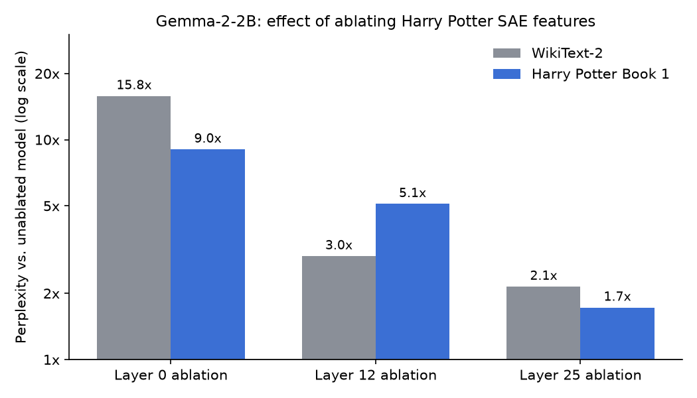
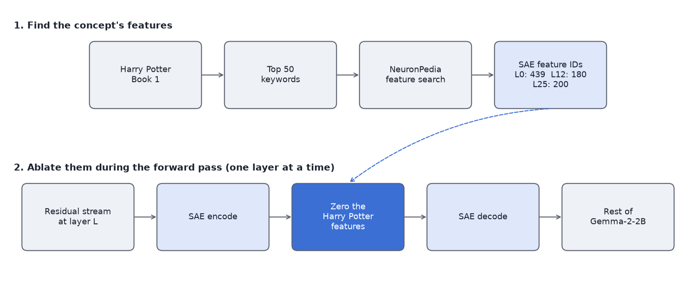
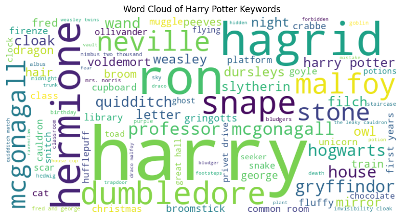
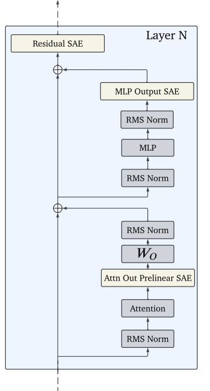

# Machine Unlearning Using Sparse Autoencoders

Can a language model forget one concept if we switch off the sparse-autoencoder (SAE) features for that concept? This project tests the idea on Gemma-2-2B, with *Harry Potter* as the concept to forget. The model weights do not change.

A course project for CS 7150 (Deep Learning) at Northeastern University, Spring 2025, by Anirudh Belaguppa Manjunath with Sri Harsha P. Full write-up: [project report on the Bau Lab expo site](https://expo.baulab.info/2025-Spring/AnirudhDesai777/).

## Key result



- **Layer 12 is the most selective.** Perplexity on Harry Potter text rises 5.1x, compared with 3.0x on general text (WikiText-2).
- **Layer 0 breaks the model.** Perplexity rises on all text, and generations become HTML-tag noise.
- **Layer 25 changes little.** The increase is 2.1x or less on both datasets.

Ablation at a middle layer can target the concept, but the cost to general text is still large.

## Why this approach

Fine-tuning or retraining can remove knowledge from a model. These methods are expensive, can damage unrelated knowledge, and do not show what changed inside the model. SAE features are interpretable, so ablating them shows exactly which internal features the model lost.

## Method



1. Count keywords in *Harry Potter and the Philosopher's Stone* and keep the 50 most frequent.
2. Search NeuronPedia for Gemma Scope SAE features that match each keyword. This gives 439 features at layer 0, 180 at layer 12 and 200 at layer 25.
3. Add a forward hook at one layer. The hook encodes the residual stream with the SAE, sets the Harry Potter features to zero, and decodes.
4. Measure perplexity on 1,000 samples of each dataset: WikiText-2, WikiText-2 with Harry Potter keywords removed, and passages from the book.

<p align="center">
  
  
</p>
<p align="center"><em>Left: Harry Potter keywords used for feature search. Right: SAE locations in a Gemma 2 layer. This project uses the residual SAE. Diagram from Lieberum et al., 2024.</em></p>

Setup: Gemma-2-2B, Gemma Scope residual-stream SAEs (16k width), [TransformerLens](https://github.com/TransformerLensOrg/TransformerLens) and [SAELens](https://github.com/jbloomAus/SAELens).

## Results

Perplexity on 1,000 samples per dataset. A good unlearning result raises perplexity on the Harry Potter text and keeps it low on WikiText-2.

| Setting | WikiText-2 | WikiText-2, keywords removed | Harry Potter Book 1 |
|---------|-----------:|-----------------------------:|--------------------:|
| No ablation | 17.93 | 18.37 | 26.94 |
| Layer 0 ablation | 283.47 | 284.02 | 243.55 |
| Layer 12 ablation | 52.98 | 54.14 | 137.55 |
| Layer 25 ablation | 38.50 | 39.19 | 46.45 |

Generation samples show the same pattern. After layer 12 ablation, "Who is Harry Potter?" still gets an answer about a fictional character. The answer loses the specifics and starts to repeat itself.

## Limitation

The hook replaces the residual stream with the SAE reconstruction. Some of the perplexity increase therefore comes from reconstruction error, not from the ablation. We did not measure a reconstruction-only baseline (the SAE with no features set to zero). That baseline is the first control to add.

## Repository layout

```
notebooks/gemma2_2b_unlearning.ipynb   Full experiment: baselines, feature search, ablation, evaluation
data/keywords.txt                      Harry Potter keywords for feature search and text cleaning
data/top_features_by_layer.txt         SAE feature IDs returned by NeuronPedia, by layer
figures/                               README figures and the scripts that draw them
site/                                  Source of the expo report page
```

To redraw a figure, run `python figures/make_perplexity_figure.py figures/perplexity_ablation.png` or `python figures/make_method_figure.py figures/method.png`. Both scripts need only matplotlib.

## Run the notebook

The notebook runs in Google Colab on an A100 GPU (40 GB).

1. Install `transformer_lens` and `sae_lens`. The first cell does this.
2. Set `HF_TOKEN` as a Colab secret. Your Hugging Face account needs access to `google/gemma-2-2b`.
3. Set a NeuronPedia API key (from https://www.neuronpedia.org) before the feature-search cell:
   ```python
   import os
   os.environ["NEURONPEDIA_API_KEY"] = "..."
   ```
4. Supply your own plain-text copy of *Harry Potter and the Philosopher's Stone*. The book is copyrighted, so this repository does not include it. The notebook reads the book and `keywords.txt` from `/content/drive/MyDrive/Unlearning/`. Copy both files there, or edit the paths in the data-loading cell.

## References

- Lieberum et al., 2024. *Gemma Scope: Open Sparse Autoencoders Everywhere All At Once on Gemma 2.*
- Eldan and Russinovich, 2023. *Who's Harry Potter? Approximate Unlearning in LLMs.*
- Cao and Yang, 2015. *Towards Making Systems Forget with Machine Unlearning.*
- [NeuronPedia](https://www.neuronpedia.org), for feature explanations and search.
