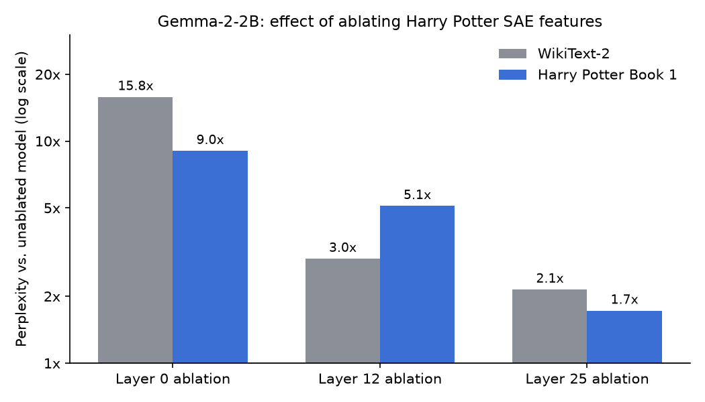

# Machine Unlearning Using Sparse Autoencoders

A course project for CS 7150 (Deep Learning) at Northeastern University, Spring 2025, by Anirudh Belaguppa Manjunath with Sri Harsha P.

**Problem.** Removing one body of knowledge from a language model usually means fine-tuning or retraining. Those methods are expensive, often damage unrelated knowledge, and do not show what changed inside the model. This project asks whether a concept can be unlearned in a way that can be interpreted, by switching off specific sparse-autoencoder (SAE) features while leaving the model's weights untouched.

**Approach.** The target concept is *Harry Potter*, and the model is Gemma-2-2B with Google's Gemma Scope residual-stream SAEs (16k width) at layers 0, 12 and 25. The 50 most frequent Harry Potter keywords from *Philosopher's Stone* were searched on NeuronPedia to collect matching SAE features: 439 at layer 0, 180 at layer 12 and 200 at layer 25. A forward hook encodes the residual stream with the SAE, zeroes those features and decodes. Perplexity was then measured on 1,000 samples each of WikiText-2, WikiText-2 with Harry Potter keywords removed, and passages from the book.

**Result.** Ablating at layer 12 was the most selective setting. Perplexity on Harry Potter text rose 5.1x, compared with 3.0x on WikiText-2. Layer 0 ablation broke the model on everything, and layer 25 changed little. Ablation at some layers can target the concept, but the cost to general text is still large.

Full write-up: [project report on the Bau Lab expo site](https://expo.baulab.info/2025-Spring/AnirudhDesai777/).

## Results



| Setting | WikiText-2 | WikiText-2, keywords removed | Harry Potter Book 1 |
|---------|-----------:|-----------------------------:|--------------------:|
| No ablation | 17.93 | 18.37 | 26.94 |
| Layer 0 ablation | 283.47 | 284.02 | 243.55 |
| Layer 12 ablation | 52.98 | 54.14 | 137.55 |
| Layer 25 ablation | 38.50 | 39.19 | 46.45 |

Perplexity on 1,000 samples per dataset, from the outputs saved in `Gemma_2_2b_Unlearning.ipynb`. The figure plots each ablated value divided by the unablated value. `figures/make_perplexity_figure.py` regenerates it.

Generation samples in the notebook show the same pattern. After layer 12 ablation, "Who is Harry Potter?" still gets an answer about a fictional character, but it loses the specifics and starts repeating itself. After layer 0 ablation the output is HTML-tag noise.

**Limitation.** The hook replaces the residual stream with the SAE's reconstruction. Some of the perplexity increase therefore comes from reconstruction error, not from the ablation itself. A reconstruction-only baseline (SAE with no features zeroed) was not measured, and it is the first control to add.

## Repository contents

| File | Purpose |
|------|---------|
| `Gemma_2_2b_Unlearning.ipynb` | Full experiment: baselines, feature search, ablation, perplexity and generation |
| `keywords.txt` | Harry Potter keyword list used for feature search and text cleaning |
| `Top features retrieved.txt` | SAE feature indices returned by NeuronPedia per layer |
| `figures/` | Results figure and the script that draws it |
| `index.html`, `style.css`, `sae_locations.png` | Source of the expo report page |

## Running the notebook

The notebook was written for Google Colab with an A100 GPU (40 GB).

1. Install `transformer_lens` and `sae_lens` (the first cell does this).
2. Set `HF_TOKEN` as a Colab secret. Your Hugging Face account needs access to `google/gemma-2-2b`.
3. Set a NeuronPedia API key (from https://www.neuronpedia.org) in the environment before the feature-search cell:
   ```python
   import os
   os.environ["NEURONPEDIA_API_KEY"] = "..."
   ```
4. Supply your own plain-text copy of *Harry Potter and the Philosopher's Stone*. The book text is copyrighted and is not distributed in this repository. The notebook reads it, together with `keywords.txt`, from `/content/drive/MyDrive/Unlearning/`. Put both files there or edit the paths in the data-loading cell.

## References

- Lieberum et al., 2024. *Gemma Scope: Open Sparse Autoencoders Everywhere All At Once on Gemma 2.*
- Eldan and Russinovich, 2023. *Who's Harry Potter? Approximate Unlearning in LLMs.*
- Cao and Yang, 2015. *Towards Making Systems Forget with Machine Unlearning.*
- [NeuronPedia](https://www.neuronpedia.org), used for feature explanations and search.
